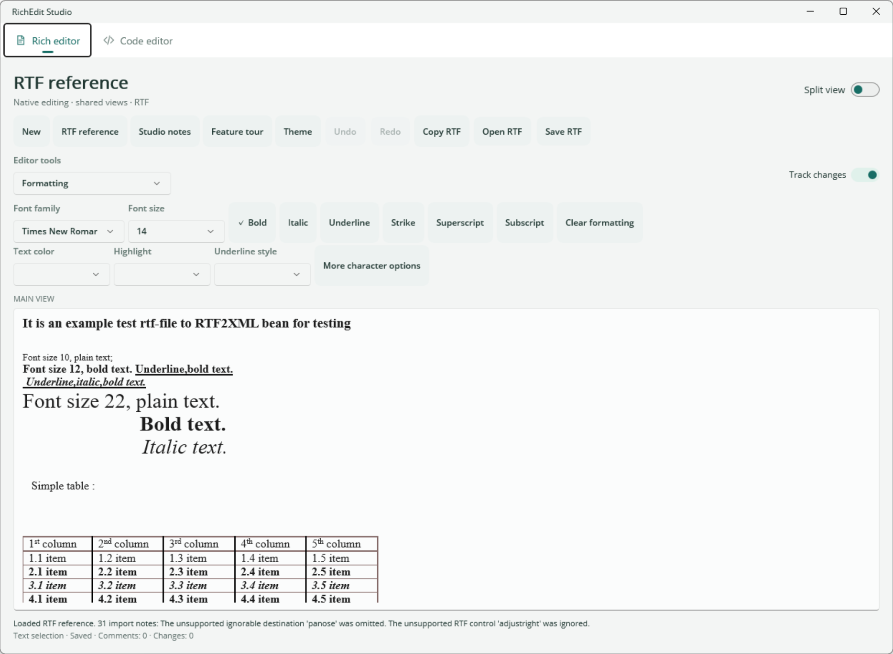
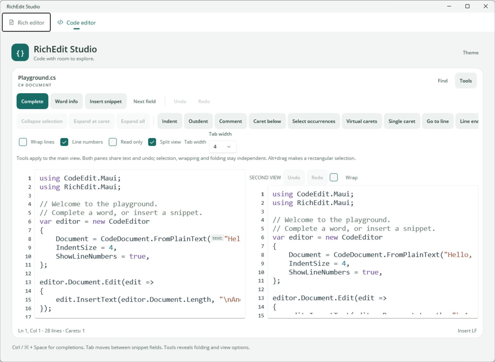

# Native editors for .NET MAUI

RichEdit.Maui provides structured rich editing with semantic tables and lists, reusable styles, annotations, RTF persistence, shared history, and native review views. CodeEdit.Maui provides plain-source editing with multiple carets, syntax presentation, folding, and transactional input extensions.

Both controls use native text engines and input on Windows, Android, iOS, and Mac Catalyst. RTF is the sole rich-document interchange format. The platform-independent document cores support immutable background reads and checked edits.

[Get started](manual/getting-started.md) · [User manual](manual/index.md) · [API reference](api/index.md) · [RTF support](manual/rtf-support.md) · [Migration to 0.5](manual/migration-0.5.md)

Read the [platform profile](manual/platforms.md) for rendering, large-document, and accessibility boundaries of 0.5.0-preview.1.

[Source on GitHub](https://github.com/hez2010/RichEdit.Maui) · [RichEdit.Maui on NuGet](https://www.nuget.org/packages/RichEdit.Maui) · [CodeEdit.Maui on NuGet](https://www.nuget.org/packages/CodeEdit.Maui)
